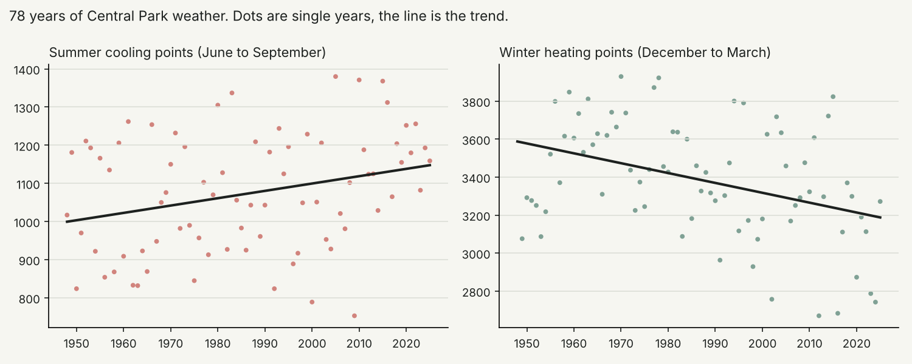
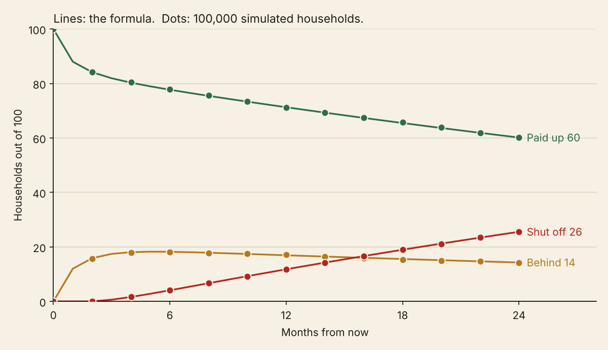

# Python in this project

Two jobs: keeping the website's weather current, and double-checking the
shutoff model.

## 1. Weather pipeline and climate trend (`update_weather.py`)



The site used to run on a weather archive that stopped in 2015. Now it
runs on NOAA's official monthly heating and cooling degree days for the
Central Park station, 1948 to 2025.

```
python python/update_weather.py            # download fresh data from NOAA and rebuild
python python/update_weather.py --offline  # rebuild from the CSV already saved here
```

What it does:

- Downloads the monthly numbers ten years at a time.
- Checks them. No month can be missing or repeated, and each month's
  heating minus cooling points has to equal days times (65 minus the
  average temperature), which is just the definition. 942 of 945 months
  agree within 3.5 points. Three months in 1950 and 1951 are off by 50 to
  61. A second download gave the same numbers, so they're NOAA's own and
  they stay as published.
- Writes `shiny_app/data/nyc_degree_days.csv`, which the app reads when it
  starts. The app treats the last 30 years as normal.
- Fits a straight line through 78 summers (June to September cooling
  points) and 77 winters (December to March heating points) with least
  squares, and writes the results the site shows in "Is it getting more
  expensive?"

What it found:

| | Change per decade | 95% range | Over 1948 to 2025 |
|---|---|---|---|
| Summer cooling points | +19 | +4 to +34 | about 15% more |
| Winter heating points | -52 | -81 to -23 | about 11% less |

Both ranges stay on one side of zero, so the shift is real. One honest
catch: weather in back-to-back years isn't fully independent, and the
range assumes it is, so the true range is probably a bit wider.

`test_update_weather.py` has 10 tests: it catches a missing month, a
repeated month, and a typo, drops an unfinished year, recovers a known
slope from fake data, and checks the t-value math against a textbook
table.

## 2. The shutoff model, rebuilt in Python

The website runs on R. I rebuilt one piece of it in Python, the part that
estimates how likely a household is to get its power shut off, and then
checked it two ways.



### What's in here

| File | What it does |
|---|---|
| `markov_shutoff.py` | The model in NumPy. Builds the month-to-month transition matrix, solves it exactly with the fundamental matrix N = (I − Q)⁻¹, and also simulates households one month at a time |
| `test_markov_shutoff.py` | 26 tests. The main ones check the Python answers against the R code the live site runs |
| `export_r_reference.R` | Pulls the model functions straight out of `shiny_app/app.R` and saves their answers for 21 input combinations to `r_reference.json` |
| `comparison_output.txt` | The formula vs simulation table below |

### Check 1: does Python match the website?

`export_r_reference.R` doesn't copy the R model, it reads the actual
functions out of the app file and runs them. The tests then feed the same
inputs to the Python version. Every transition matrix, every month of the
24-month timeline, and the average time to shutoff match to 12 decimal
places across all three risk tiers and seven bill-to-income levels.

### Check 2: does the formula match reality (well, a simulated one)?

The fundamental matrix gives an exact answer, but an exact answer from a
formula is only as good as my algebra. So `simulate()` ignores the formula
completely. It starts 400,000 made-up households paid up, rolls dice for
each one every month using the same probabilities, and counts what
happens.

```
tier      stress   P(shutoff in 12 mo)   simulated      avg months  simulated
Low         0.05                0.0118   0.0118±0.0003       740.9      740.4
Elevated    0.12                0.1179   0.1177±0.0010        74.3       74.3
High        0.30                0.7343   0.7338±0.0014        10.2       10.2
```

(Full table in `comparison_output.txt`. "stress" is the monthly bill as a
share of monthly income.)

Across all nine rows the two methods never differ by more than 0.12
percentage points, which is about the size of gap random dice rolls
produce at this sample size. That's the point of doing it twice.

### Run it

(For the shutoff model. The weather commands are above.)

```
pip install numpy matplotlib pytest
python python/markov_shutoff.py      # prints the table, saves the chart
python -m pytest python              # runs all 36 checks
Rscript python/export_r_reference.R  # only if the R app changes
```

### Being honest about what this proves

It proves the code does what the model says. It does not prove the model
is right about real people. The chance an account slips from paid up to
late comes from the risk tiers I fit on real meter data, but what happens
after that (catching up vs falling further behind) uses probabilities I
chose, because no public dataset tracks it. The main report stress-tests
those choices.
